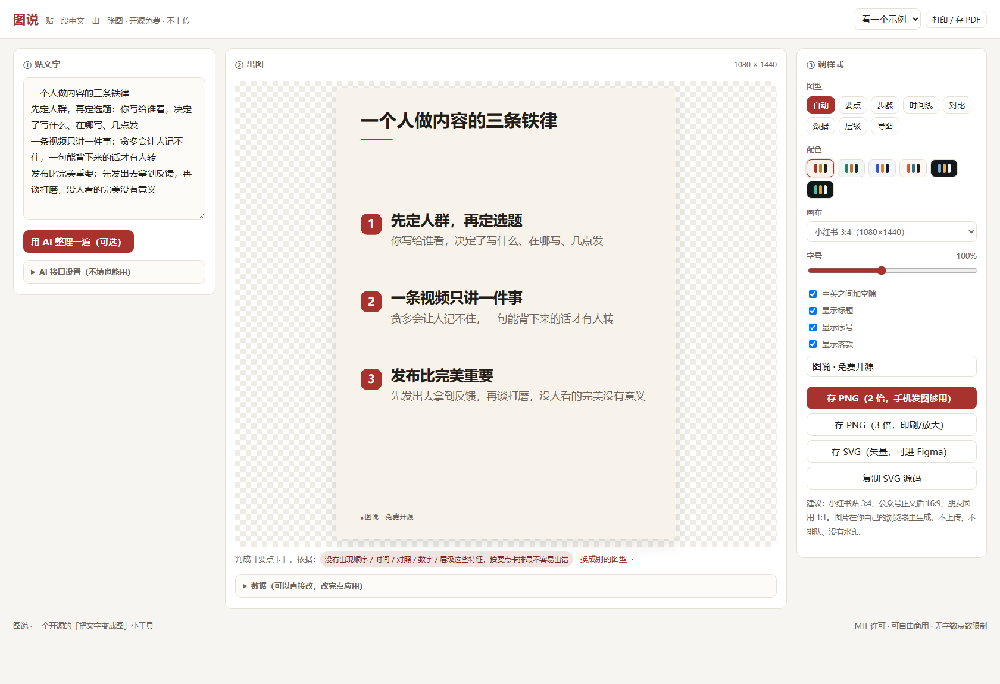
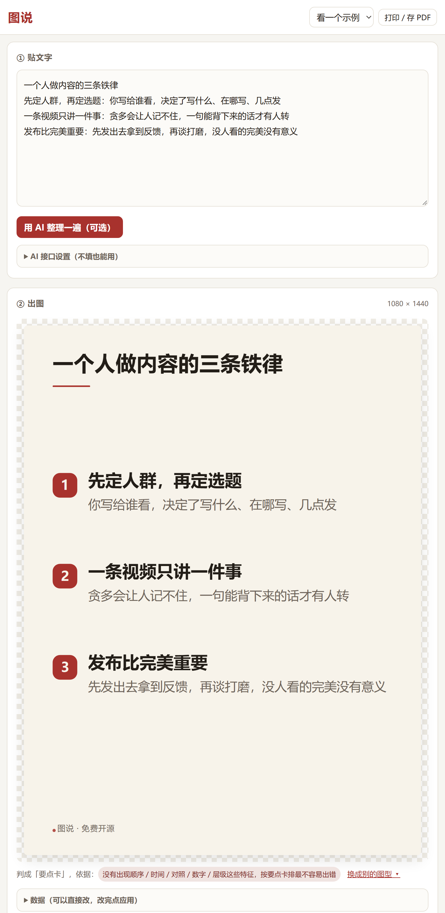
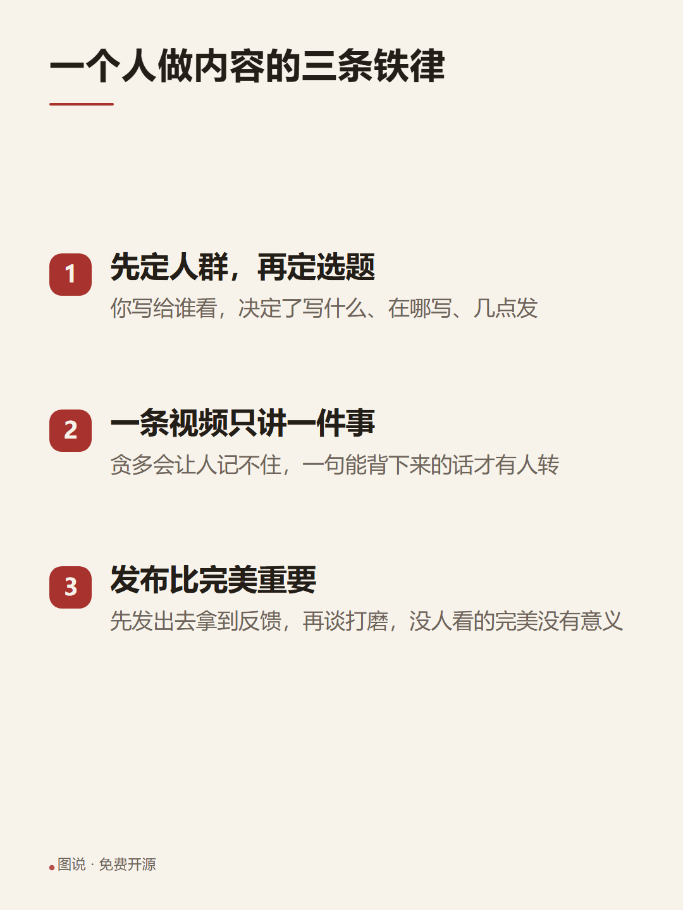
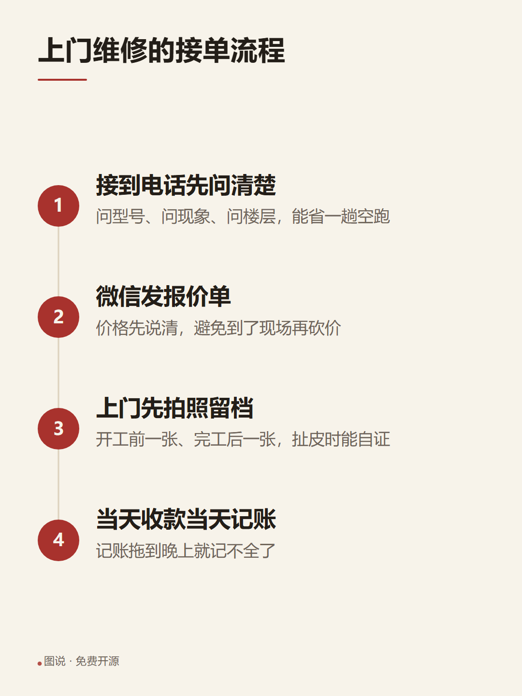
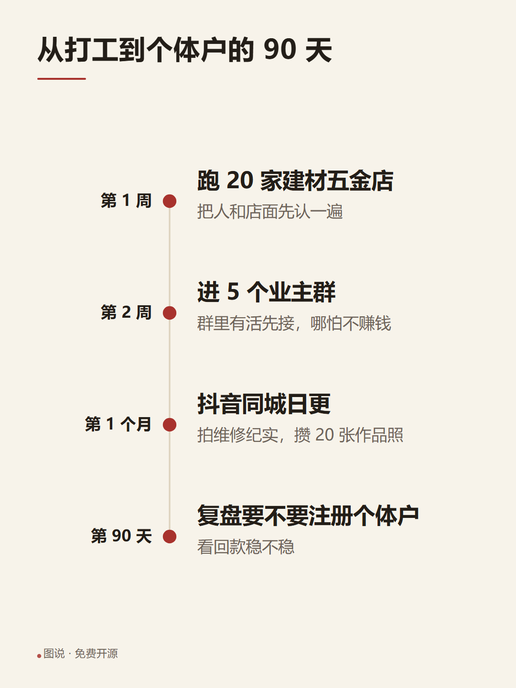
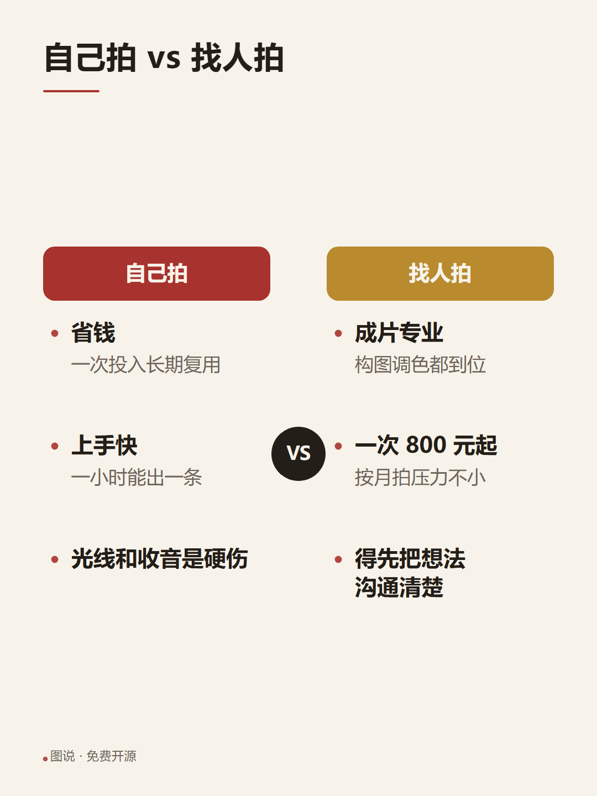
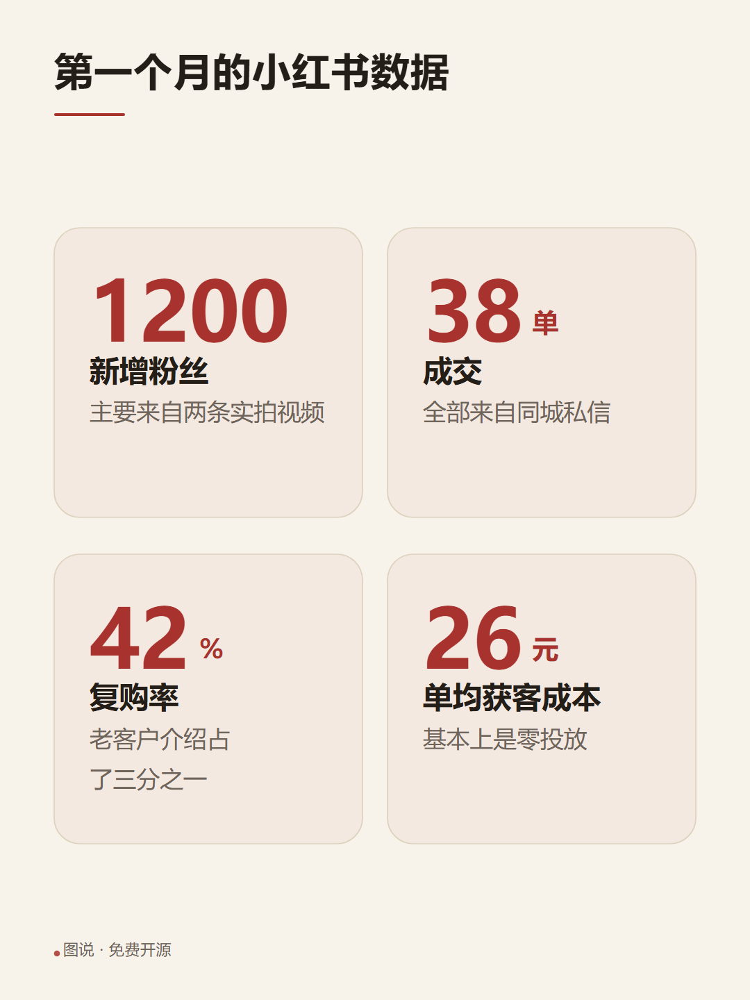
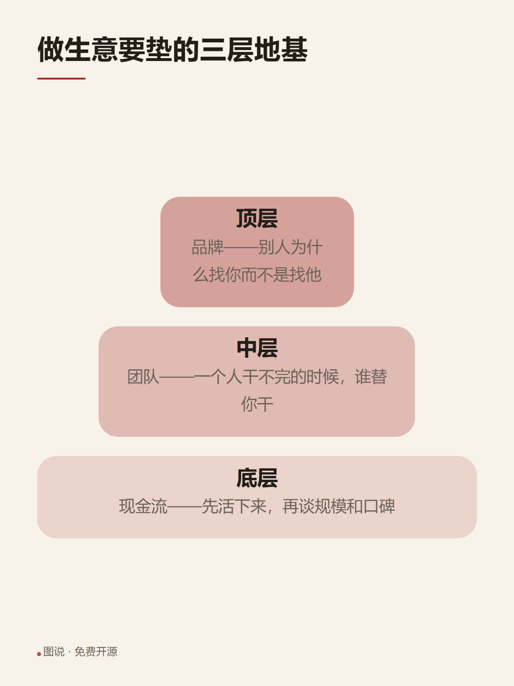
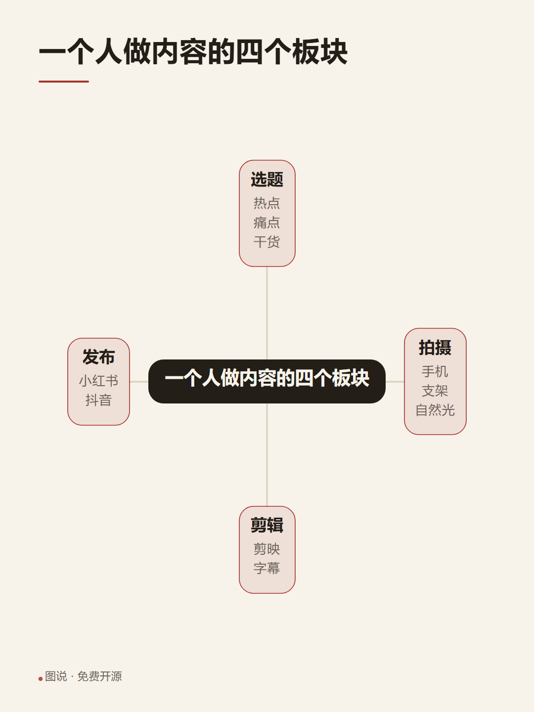

# 图说

**贴一段中文，出一张能直接发出去的图。**

不用登录、不用联网、不上传、没有字数点数、没有水印。七种图型自己判，判错了可以一键换。



手机上打开是这个样子（同一套页面，自适应）：



---

## 为什么自己做

对标的是 [Napkin AI](https://www.napkin.ai/)（"Turn Text into AI Diagrams and Visuals"）——
把一段文字自动变成流程图、对比图、时间线、数据卡，这个思路非常好用，但国内用起来有几道坎
（下面是 2026-10 从它官网定价页抄下来的原话，不是猜的）：

| 它的现状 | 对中文用户的麻烦 |
| --- | --- |
| 免费版 `500 AI credits per week`，约一个字算 1 点，且 `Napkin branding on visuals`（成品带它的水印） | 中文按字烧点数很快；想干净出图必须付费 |
| 去水印、导出 PPT / SVG 要 `$9 per person / month`，只收外币卡 | 国内没外币卡就得卡在这一步 |
| 全英文界面、英文优先的排版 | 中文标点、断行、行高、中英混排，它不会专门处理 |
| 稿子上传到国外服务器 | 做自媒体的人贴的是没发布的内容，心里不舒服 |

所以这个工具保留它的核心思路（**从文字直接出图，不用写提示词**），把上面四件事反过来做：
离线、免费、开源、按中文排版规矩排。

## 七种图型

图型靠一份**可复核的中文规则**判断，界面会把"凭什么判成这个"列出来；判错了直接点别的图型。

| 图型 | 长什么样 | 适合什么 |
| --- | --- | --- |
| 要点卡 |  | 铁律、清单、几条经验 |
| 步骤流程 |  | 服务流程、操作步骤、SOP |
| 时间线 |  | 规划、复盘、阶段目标 |
| 左右对比 |  | 优点缺点、A 方案 B 方案 |
| 数据卡 |  | 月度数据、成绩单、报价 |
| 层级金字塔 |  | 分层结构、从基础到顶层 |
| 思维导图 |  | 一个主题的几个板块 |

画布尺寸按国内平台的常见规格备好了：小红书 3:4、方图 1:1、竖屏 9:16、横屏 16:9、
公众号头图 2.35:1、PPT 4:3。配色六套（宣纸 / 青瓷 / 靛蓝 / 朱砂 / 夜幕 / 墨玉），
导出 PNG（2 倍、3 倍）、SVG、复制 SVG 源码、或者直接打印成 PDF。

## 用起来

**最省事**：双击 `index.html`，浏览器里就能用（离线可用，什么都不用装）。

**要让手机也能打开**：双击 `start.cmd`（桌面上那个「图说」图标就是它）。
它会起一个本机服务、自动打开浏览器，并在窗口里打印一个局域网网址和二维码 ——
手机连同一个 Wi-Fi 扫一下就能用，不用装 App、不用注册。

**手机上画布太小？** 界面右侧「画布」选你要发的比例，图会自动按那个比例重排。

## 中文排版上到底做了什么

这部分是国外工具不会替你做的，也是这个项目真正花时间的部分：

- **避头尾**：行首不出现 `，。、；：？！）】》」』`，行尾不出现 `（《「『`；标点允许轻微悬挂。
- **不留孤字**：最后一行只剩一个字时，把最后两行重新匀一次。
- **中英混排**：汉字和英文/数字交界处自动补一点空隙（可关掉），中文标点本身自带留白，不重复加。
- **中文字体栈**：微软雅黑 → 苹方 → 思源黑体一路兜底，全部用系统字体，不下载任何字体文件。
- **行高按中文给**：正文 1.72、标题 1.32 —— 中文方块字比英文矮宽，行高给不够就会糊成一片。
- **按可用高度自适应**：先按字号缩放（0.55～1.3 倍），再把剩余空间摊到条目间距上，尽量铺满画布又不溢出。
- **字宽真测**：用 `canvas.measureText` 真实量宽再断行，不是拿"一个汉字算一个字宽"估算。

规则的词表是可以改的：`assets/engine.js` 顶部有一组关键词（`词_流程`、`词_对比`、`词_层级`…），
想让某类内容判得更准，改那几个正则就行，不用碰渲染代码。

## 可选：接一个 AI 接口

不填任何 Key，图型靠上面那套规则判断，功能是完整的。

如果你有国内任意一家 OpenAI 兼容接口（DeepSeek、通义、智谱、魔搭…），
在界面「AI 接口设置」里填上接口地址 / 模型 / Key，就可以让模型直接把文字整理成结构
（更懂语义，尤其适合乱糟糟的草稿）。Key 只存在你自己浏览器的 localStorage 里，
请求从浏览器直接发往你填的地址，不经过任何中间服务器。

注意：AI 通道要走 `start.cmd` 打开（`http://127.0.0.1`）。
直接双击 `index.html` 是 `file://` 协议，浏览器会拦掉对外的跨域请求 —— 规则判型不受影响，照常能用。

发给模型的原话就摆在界面上（可展开查看），改了以后想调整效果，直接改 `assets/app.js` 里的 `提示词`。

## 自检

```bash
node tools/selftest.js
```

不装任何依赖，跑 68 项断言：中文断行是否守住避头尾、有没有孤字、英文单词有没有被切断、
七种图型 × 六种画布能不能渲染出合法 SVG（还会检查有没有 `NaN`、标签是否配对、内容有没有超出画布）。

导出这条路（SVG → canvas → PNG）用真实浏览器验证：

```bash
chrome --headless=new --dump-dom --virtual-time-budget=6000 tools/导出自检.html
```

## 目录结构

```
index.html          界面（双击就能用）
assets/
  typography.js     中文排版：量宽、断行、避头尾、孤字、中英混排
  engine.js         规则引擎：判图型 + 切结构（纯函数，node 里能直接测）
  themes.js         六套配色
  render.js         七种图型的布局与 SVG 输出
  export.js         PNG / SVG 导出（全在浏览器本地完成）
  app.js            界面逻辑
  app.css           界面样式
  图说.ico          图标（由 tools/做图标.py 生成）
start.cmd / start.py  本机起服务 + 手机扫码入口
tools/selftest.js   自检
tools/做图标.py      重新生成图标
tools/导出自检.html   无头浏览器里验证导出路径
docs/images/        README 用的示例图（就是图说自己出的图）
```

生成出来的图是**原生 SVG 图元**（不是把网页截成图片），所以 SVG 导出可以直接丢进
Figma / Illustrator / Word 继续改，PNG 也是矢量渲染出来的，放大不虚。

## 已知限制

说实话的部分：

- 每个图型有上限（要点卡 8 条、步骤 7 步、时间线 7 个、对比每侧 5 条、数据 6 个、导图 6 个分支）。
  超了界面会明确告诉你省略了几条，而不是悄悄丢掉。
- 出图后**不能拖拽改位置**：要改的是文字和数据（界面里的「数据」框可以直接改 JSON）。
  Napkin 那种自由拖拽编辑比这强，那是它的核心投入，这里没做。
- 不能导出 PPTX（可以打印成 PDF，或者导出 SVG 再插进 PPT）。
- 规则判型是"够用"而不是"聪明"：它就是一组中文关键词 + 结构特征，
  会判错，所以界面上永远留着"换成别的图型"。

## 之后可以做

- 拖拽编辑（在 SVG 上加选中与移动）
- 更多图型：四象限、漏斗、循环、案例卡
- 一次贴多个主题，批量出一组图
- 直接导出 PPTX
- 做成公众号 / 小红书的固定模板（标题栏、页脚、头像位）

## 许可

MIT，随便用，商用也行。
Copyright (c) 2026 胡炜杰
